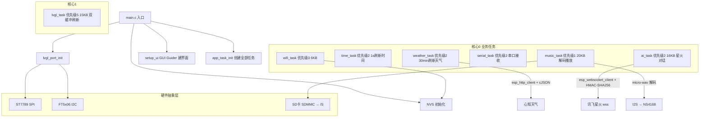

# ESP32-S3 智能终端 · 面试复习手册

> 项目路径：`D:\SoftWare-Data\ESP32\project\esp32s3_terminal`
> 配套代码：本手册所有要点均标注了对应源文件，复习时务必"对照代码"再"合上讲出来"。
> 使用建议：每天按模块过一遍，最后用"无代码复述"检验（合上编辑器讲 5 分钟，录音回听）。

---

## 目录

1. [项目一句话定位](#1-项目一句话定位)
2. [硬件资源与环境配置](#2-硬件资源与环境配置)
3. [系统架构总览](#3-系统架构总览)
4. [启动流程](#4-启动流程)
5. [任务系统（RTOS 重点）](#5-任务系统rtos-重点)
6. [BSP 驱动层](#6-bsp-驱动层)
7. [LVGL 移植与 UI 层](#7-lvgl-移植与-ui-层)
8. [功能模块详解](#8-功能模块详解)
9. [游戏模块](#9-游戏模块)
10. [内存管理与线程安全](#10-内存管理与线程安全)
11. [高频面试问题清单](#11-高频面试问题清单)
12. [项目软肋与追问应对](#12-项目软肋与追问应对)
13. [项目自述模板](#13-项目自述模板)
14. [复习打卡计划表](#14-复习打卡计划表)

---

## 1. 项目一句话定位

> **基于 ESP32-S3 的桌面智能终端**：双核 FreeRTOS + PSRAM + LVGL 8.3 GUI，实现 WiFi 联网、SNTP 校时、心知天气、讯飞星火 AI 对话（WebSocket）、WAV 音乐播放（I2S + NS4168）、串口终端，以及 2048 / 植物大战僵尸 / 消消乐 / 羊了个羊四个游戏。**分层清晰：BSP → Middleware → App 任务 → UI。**

### 1.1 可以讲的亮点（面试开场用）
- 完整的分层架构（BSP / Middleware / App / UI），模块解耦、通过队列/信号量通信
- 双核任务分配：LVGL 独占 core1，6 个业务任务在 core0
- 技术栈覆盖面广：SPI/I2C/I2S/SDMMC 外设驱动、WiFi 协议栈、HTTP/WebSocket 网络、HMAC-SHA256 鉴权、JSON 解析、RTOS 多任务
- 每个功能都有真实业务闭环（联网→取数→UI 呈现），不是 demo 堆砌

---

## 2. 硬件资源与环境配置

### 2.1 核心配置（来自 `sdkconfig`）
| 项 | 值 | 说明 |
|---|---|---|
| 主控 | ESP32-S3 | 双核 Xtensa LX7，240MHz |
| Flash | 16MB | `CONFIG_ESPTOOLPY_FLASHSIZE_16MB` |
| PSRAM | Octal 80MHz | `CONFIG_SPIRAM=y`，`CONFIG_SPIRAM_USE_CAPS_ALLOC=y` |
| FreeRTOS | 1000Hz tick | `CONFIG_FREERTOS_HZ=1000` |
| LVGL | 8.3.11 | `components/lvgl` |
| 颜色深度 | 16bit (RGB565) | `CONFIG_LV_COLOR_DEPTH_16` |
| LVGL 内存池 | 64KB | `CONFIG_LV_MEM_SIZE_KILOBYTES=64` |
| 刷新周期 | 30ms | `CONFIG_LV_DISP_DEF_REFR_PERIOD=30` |

### 2.2 分区表（`partitions_16MB.csv`）
```
nvs,      data, nvs,     , 0x6000   # WiFi 凭证、游戏最高分、设置项
phy_init, data, phy,     , 0x1000
img,      data, spiffs,  , 512K
model,    data, spiffs,  , 3M
factory,  app,  factory, , 10M
```
- **自定义分区表**：`sdkconfig` 中 `CONFIG_PARTITION_TABLE_CUSTOM=y`
- app 区 10M 足够放四个游戏的图片资源（图片以 C 数组形式编译进固件）

### 2.3 外设引脚速查
| 外设 | 接口 | 引脚 | 参考文件 |
|---|---|---|---|
| LCD ST7789 | SPI2 (MOSI/CLK/CS/DC/RST/BL) | 7/15/4/6/5/16 | `components/bsp/bsp_lcd/bsp_lcd.h` |
| 触摸 FT6336U(FT5x06) | I2C0 (SDA/SCL) | 3/18 | `components/bsp/bsp_touch/bsp_touch.h` |
| SD 卡 | SDMMC 1bit (CLK/CMD/D0/CS) | 14/10/17/9 | `components/bsp/bsp_sdcard/bsp_sdcard.c` |
| 功放 NS4168 | I2S0 (BCLK/LRC/DOUT) | 40/41/39 | `components/app/music/music.c` |
| 串口 UART1 | TX/RX | 43/44 | `components/app/serial/serial.h` |

> **记忆技巧**：LCD 用 SPI（高速刷屏），触摸用 I2C（低速、引脚少），SD 卡用 SDMMC 1bit（比 SPI 快），音频用 I2S（连续流式）。

---

## 3. 系统架构总览

### 3.1 架构图



### 3.2 分层职责（面试常问"怎么分层"）
| 层 | 目录 | 职责 | 典型文件 |
|---|---|---|---|
| 入口 | `main/` | NVS、LVGL 初始化、建 UI、启动任务 | `main.c` |
| 应用层 | `components/app` | 任务调度 + 功能模块 + 游戏 | `app_task/`、`wifi/`、`music/`… |
| 中间层 | `components/middleware` | LVGL 显示/触摸移植、URL 编码 | `lvgl_port/`、`url_encode/` |
| BSP | `components/bsp` | 外设驱动封装 | `bsp_lcd/`、`bsp_touch/`、`bsp_sdcard/` |
| UI | `components/ui` | GUI Guider 生成界面 + 自定义 | `generated/`、`custom/custom.c` |
| 第三方 | `components/` | lvgl 8.3.11、esp_lvgl_port、esp_lcd_*、esp_websocket_client、micro-wav | 直接引用 |

### 3.3 关键依赖（`components/app/CMakeLists.txt`）
```
driver freertos heap esp_common esp_wifi esp_netif nvs_flash esp_event
esp_http_client mbedtls esp_websocket_client sdmmc fatfs json micro-wav bsp middleware ui
```
> 说明 app 层依赖：WiFi 协议栈、HTTP/WebSocket（mbedtls 提供 TLS）、SD/FATFS、cJSON（json）、自有 bsp/middleware/ui。

---

## 4. 启动流程

### 4.1 `app_main` 步骤（`main/main.c`）
```c
1. nvs_flash_init()；若返回 ESP_ERR_NVS_NO_FREE_PAGES 或 NEW_VERSION_FOUND
   → nvs_flash_erase() 后重新 init        // NVS 分区损坏/版本升级时擦除重建
2. lv_port_init()
   ├─ bsp_lcd_init()    // SPI 总线 → 创建面板 → reset/init/swap_xy/mirror → 背光亮
   ├─ bsp_touch_init()  // I2C 总线 → 创建 touch IO → FT5x06 驱动
   ├─ lvgl_port_init()  // 创建 LVGL 任务（core1, prio5, 15KB）
   └─ 添加显示 + 触摸设备
3. lvgl_port_lock(0) → setup_ui(&guider_ui) → lvgl_port_unlock()
   // GUI Guider 生成界面，锁内创建保证线程安全
4. app_task_init()
   ├─ bind_wifi_status_event_handler / bind_music_event_handler  // 绑定事件回调
   └─ create_wifi_task / datetime / weather / serial / music / ai_task
5. while(1) vTaskDelay(1000)   // 主任务空转，业务全部交给独立任务
```

### 4.2 为什么 `setup_ui` 要加锁？
- LVGL 不是线程安全的，所有对 LVGL 对象树的访问（创建、修改、删除）都必须在 `lvgl_port_lock/unlock` 之间
- LVGL 任务在 core1 运行，`setup_ui` 在 main 任务（core0）执行，跨核访问必须互斥

---

## 5. 任务系统（RTOS 重点）

### 5.1 任务清单（`components/app/app_task/app_task.c`）
| 任务 | 优先级 | 栈 | Core | 周期/触发 | 职责 |
|---|---|---|---|---|---|
| lvgl_task | 5 | 15KB | 1 | 33ms 最大休眠 / 5ms 定时器 | 界面刷新、事件分发 |
| wifi_task | 3 | 6KB | 0 | 队列 + 10s 周期 | 连接/断开/扫描 + 自动重连 |
| time_task | 2 | 3KB(PSRAM) | 0 | 1s（vTaskDelayUntil） | 刷新首页时间/日期/星期 |
| weather_task | 2 | 5KB(PSRAM) | 0 | 30min | 拉取天气并更新缓存 |
| serial_task | 2 | 5KB(PSRAM) | 0 | 阻塞读 + 100ms | 串口接收 → 刷新 UI |
| music_task | 1 | 20KB(PSRAM) | 0 | 信号量启停 + 50ms | WAV 解码 + I2S 播放 |
| ai_task | 2 | 16KB(PSRAM) | 0 | 队列 | 讯飞星火对话 |

> 栈分配注意：`xTaskCreatePinnedToCoreWithCaps(..., MALLOC_CAP_SPIRAM | MALLOC_CAP_8BIT)` —— **任务栈放 PSRAM**；wifi_task 用默认 `xTaskCreatePinnedToCore`（栈在内 RAM，因为 WiFi 协议栈要求内 RAM 访问）。

### 5.2 同步机制汇总（每个都要能讲）
| 机制 | 位置 | 作用 |
|---|---|---|
| 队列 | WiFi 命令队列、音乐命令队列(5)、AI 问题队列(2) | 任务间解耦，命令传递 |
| 二元信号量 | 音乐 start/stop | 启停播放循环 |
| 事件组 | 天气 HTTP 收包完成 | 事件回调 → 任务同步 |
| 互斥锁 | `lvgl_port_lock` | 所有 UI 操作加锁 |
| volatile | music 的播放/暂停标志 | 多任务可见性（注：volatile 不保证原子性，面试可展开讨论） |

### 5.3 必会考点
1. **为什么 LVGL 独占 core1？** 界面渲染是高频 + 大计算量任务，独占一核避免被业务任务打断卡顿；业务任务集中在 core0 共享 CPU。
2. **`vTaskDelayUntil` vs `vTaskDelay`**：前者按绝对时间点唤醒，不受执行耗时漂移影响，适合定周期（时间任务、天气任务）；后者是相对延时。
3. **优先级设计**：LVGL(5) > WiFi(3) > 业务(2) > 音乐(1)。音乐优先级最低是因为它靠"喂数据"保流畅，允许被抢占，但 buffer 足够；WiFi 优先级高保证断线重连及时。
4. **音乐任务的启停模式**：任务阻塞在 `xSemaphoreTake(start_sem, portMAX_DELAY)`；播放循环内非阻塞检查 stop_sem —— 经典"可随时打断的播放循环"设计。
5. **任务间共享数据**：`weather_cache_t`（天气任务写、UI 读）、music 的 volatile 状态、`wifi_req` 全局结构体——面试官问"多任务安全吗"时要有意识，能说出潜在风险和改进方案（见第 10 节）。

---

## 6. BSP 驱动层

### 6.1 LCD（`bsp_lcd.c`）
- **SPI 总线**：`spi_bus_initialize(SPI2_HOST, ..., SPI_DMA_CH_AUTO)`，传输大小 `H_RES * 40`
- **Panel IO**：`trans_queue_depth = 10`（传输队列深度，DMA 流水线）
- **面板**：`esp_lcd_new_panel_st7789`，16bpp，RGB 顺序
- **方向**：`swap_xy(true)` + `mirror(false, true)` —— 匹配屏幕物理安装方向
- **背光**：默认 GPIO 拉高点亮；`bsp_lcd_backlight_init()` 用 **LEDC PWM（5kHz, 8bit）** 实现 0~100 亮度调节
- 关键 API：`esp_lcd_panel_io_spi`、`esp_lcd_panel_*`、`esp_lcd_panel_disp_on_off`

### 6.2 触摸（`bsp_touch.c`）
- I2C master 总线（SDA3/SCL18，100kHz，`glitch_ignore_cnt=7`）
- `esp_lcd_touch_new_i2c_ft5x06` 创建驱动，`swap_xy=1, mirror_y=1` 与 LCD 方向一致
- 注意：日志里打印的是 "FT6336U"，驱动用 FT5x06 兼容
- 坐标范围：`X_MAX = 240, Y_MAX = 320`（与 LCD 宽高交叉对应，因 swap_xy）

### 6.3 SD 卡（`bsp_sdcard.c`）
- SDMMC 主机 **1bit 模式**（`SDMMC_HOST_FLAG_1BIT`，width=1）
- 挂载点 `/S`，`format_if_mount_failed=false`（不自动格式化，保护数据）
- `setlocale(LC_ALL, "zh_CN.UTF-8")` 支持中文文件名
- **懒加载设计**：`sdcard_init` 由 LVGL 的 fatfs 驱动在首次打开文件时调用（`components/lvgl/src/extra/libs/fsdrv/lv_fs_fatfs.c:94`），而不是启动时强制挂载——无卡也能开机
- `max_files=5`：最多同时打开 5 个文件（音乐播放 + 歌词等）

### 6.4 音频 I2S（`music.c` 中 `ns4168_i2s_init`）
- I2S0，主模式，Philips 标准，16bit，**单声道**（`I2S_SLOT_MODE_MONO` + `I2S_STD_SLOT_RIGHT`）
- DMA：`dma_desc_num=8`，`dma_frame_num=512`，`auto_clear=true`
- 切歌时若采样率变化 → 重新初始化 I2S（`i2s_channel_disable → del → new → init → enable`）

---

## 7. LVGL 移植与 UI 层

### 7.1 显示配置（`lvgl_port.c`）
```c
.buffer_size = 320 * 20,     // 行缓冲
.double_buffer = true,       // 双缓冲
.flags.buff_dma = true,      // 缓冲区要求 DMA 能力（内 RAM）
.flags.buff_spiram = false,  // DMA 与 SPIRAM 不能同时用（代码注释里的取舍）
.rotation = { .swap_xy=true, .mirror_y=true }
```
- **双缓冲作用**：一个缓冲在刷屏 DMA，另一个给 LVGL 画下一帧，避免撕裂（tearing）
- **为什么 buffer 必须 DMA 内存**：SPI 外设通过 DMA 搬运，要求内存连续且可被 DMA 访问（`MALLOC_CAP_DMA`）

### 7.2 UI 结构（GUI Guider 生成）
- 10 个界面：home / setting / weather / music / ai1 / calendar / gamechose / gameplay / about / serial（`components/ui/generated/setup_scr_*.c`）
- `gui_guider.h` 定义 `lv_ui` 结构体，保存所有控件指针（`guider_ui.home_time_label` 等）
- `custom.c` 预留扩展点（当前为空壳）
- `app_ui.c` 负责业务数据 → UI 绑定，是**手写代码与生成代码的粘合层**

### 7.3 UI 更新模式（重点）
- 所有 UI 更新函数都先 `lvgl_port_lock(0)` 再操作，`lv_obj_is_valid()` 防悬空指针
- **事件回调**：WiFi 状态事件（`wifi_status_event_handler`）、音乐事件、按钮点击
- **定时器刷新**：`music_ui_refresh_timer_cb` 用 LVGL 定时器轮询音乐进度/歌词（避免高频事件轰炸 UI）
- **动态列表**：WiFi 扫描结果 → `lv_list_add_btn` 逐个创建，SSID 用 `lv_obj_set_user_data` 存储，DELETE 事件里 `lv_mem_free` 释放
- **歌词渲染**：`lv_canvas_draw_text` 在画布上画"上一句/当前/下一句"，当前句高亮绿色

---

## 8. 功能模块详解

### 8.1 WiFi（`wifi.c`，368 行）
**架构**：UI/业务 → `wifi_send_cmd()` 发命令 → `g_wifi_cmd_queue` → wifi_task 执行
- 命令：`CONNECT / DISCONNECT / REFRESH`
- **事件驱动**：注册 `WIFI_EVENT`（STA_START/CONNECTED/DISCONNECTED）和 `IP_EVENT`（STA_GOT_IP），通过 `wifi_send_event()` 回调 UI 层
- **扫描**：`esp_wifi_scan_start(&cfg, true)` **阻塞扫描**，最多存 10 个 AP，结果拼成 `scan_result` 字符串
- **凭证持久化**：NVS 命名空间 `wifi_config`，保存 ssid/password/自动连接开关
- **自动重连**：wifi_task 每 10s 检查，条件 = 未连接 + 自动连接开 + 非用户主动断开 → `wifi_auto_connect()`
- 断开原因：`WIFI_EVENT_STA_DISCONNECTED` 里带 `reason` 码（日志打印）

**面试点**：为什么用队列而不是直接调 API？—— WiFi 操作（扫描/连接）耗时且可能阻塞，放独立任务不阻塞 UI；队列解耦调用方与执行方。

### 8.2 SNTP 时间（`datetime.c`）
- 轮询模式，3 个 NTP 服务器（pool.ntp.org / cn.pool.ntp.org / ntp1.aliyun.com）
- `datetime_wait_sntp_sync()`：等待系统时间 >= 2024 年判定同步成功；成功后 `setenv("TZ","CST-8")` 设东八区
- 未同步时 UI 显示 `--:--:--`
- **被复用点**：讯飞鉴权需要 GMT 时间戳，`xfyun_websocket.c` 调 `datetime_wait_sntp_sync()` 保证时间有效

### 8.3 天气（`weather.c`，心知天气 Seniverse）
- **定位**：`myip.ipip.net/json` 按 IP 反查城市（失败默认"贵港"）
- **实时**：`/v3/weather/now.json` → 温度/天气/更新时间
- **预报**：`/v3/weather/daily.json?days=3` → 未来三天
- **HTTP 实现**：`esp_http_client` + 事件回调 `HTTP_EVENT_ON_DATA` 收数据，**EventGroup 的 bit 标记收完**，`esp_http_client_perform` 同步等待；非 200 或失败返回 false
- **解析**：cJSON 解析，`copy_str_trunc` 安全拷贝，结果写入 `weather_cache_t` 静态缓存
- **任务策略**：weather_task 等 WiFi 连上后首次拉取，之后每 30 分钟刷新；UI 通过 `weather_get_cached()` 读缓存

### 8.4 讯飞星火 AI（技术含量最高，重点复习）
**两层**：
- `xfyun.c`：AI 任务 + 请求/响应协议（cJSON 构造请求、解析流式响应）
- `xfyun_websocket.c`：WebSocket 连接 + **鉴权 URL 构造** + 流式收包

**鉴权流程（HMAC-SHA256）**：
```
1. 取当前 GMT 时间 date（格式: "%a, %d %b %Y %H:%M:%S GMT"）
2. 构造签名串: "host: <host>\ndate: <date>\nGET <path> HTTP/1.1"
3. 用 API_SECRET 对该串做 HMAC-SHA256 → digest
4. digest 做 Base64 → signature
5. 拼 authorization: api_key="..", algorithm="hmac-sha256",
                      headers="host date request-line", signature=".."
6. authorization 整体 Base64 → URL 编码；date、host 也 URL 编码
7. 拼 URL: wss://host/path?authorization=..&date=..&host=..
```
- 鉴权 URL **缓存 300 秒**（`XFYUN_AUTH_URL_CACHE_SEC`），避免每次对话重复计算
- 实现细节：mbedtls 的 `mbedtls_md_hmac` + `mbedtls_base64_encode`

**WebSocket 通信**：
- `esp_websocket_client`，`crt_bundle_attach` 校验 TLS 证书（`esp_crt_bundle_attach`）
- 连接成功信号量 → 发请求 → 等完成信号量（120s 超时）
- **流式分片重组**：`WEBSOCKET_EVENT_DATA` 里 `payload_offset==0` 时开新帧缓冲，按 `payload_offset + data_len == payload_len` 判断整帧收齐
- 关闭帧 `op_code == 0x08` 视为结束

**响应解析（流式）**：
- `header.code != 0` → 报错；`header.status == 2` → 会话结束
- `payload.choices.text[].content` 增量拼接到 UI（`ai_ui_set_answer` / `ai_ui_append_answer` 流式显示）

### 8.5 音乐播放（`music.c`，815 行）
**数据通路**：SD 卡 WAV 文件 → `fread` → micro-wav 解码（C++ 桥接 `wav_decoder_bridge.cpp`）→ PCM 缓冲 → 音量缩放 → I2S 写 → NS4168 功放

**要点**：
- 只支持 **44.1kHz / 16bit** WAV（头部校验，不支持就报错返回）
- 扫描 `/S/MUSIC` 目录，`.wav` 后缀，最多 128 首（`MUSIC_MAX_FILES`）
- **状态机**：`decode_and_play_frame()` 根据解码结果 `NEED_MORE_DATA / SUCCESS / HEADER_READY / END_OF_STREAM` 循环推进，`s_wav_pending_bytes` 保留未消费数据
- **声道处理**：立体声 → 左右平均混成单声道（`prepare_ns4168_output`）
- **音量**：软件缩放 `val * percent / 100`（定点：`*256>>8`）
- **进度**：按"已写采样数 / 总采样数"计算（`s_elapsed_samples / s_total_samples`），不依赖系统时间
- **歌词**：同目录 `.lrc` 解析，支持多时间戳行，按时间排序；`find_current_lyric_index` 根据 elapsed 找当前句
- **播放控制**：命令队列（播放/暂停/上一首/下一首/音量/扫描），事件回调通知 UI

### 8.6 串口终端（`serial.c`）
- UART1，115200，8N1，TX43/RX44，收发各 1024B 环形缓冲
- serial_task 阻塞读（100ms 超时轮询 active 标志），数据经 `update_serial_display` 追加到 UI 文本框
- 文本框上限 3000 字符，超限**丢弃最旧部分**；自动滚动到底部
- `serial_set_rx_active` 控制接收开关（避免非激活时占用 CPU）

---

## 9. 游戏模块

| 游戏 | 文件 | 说明 |
|---|---|---|
| 2048 | `lv_100ask_2048/` | 开源组件，经典 4x4 合并算法 |
| 植物大战僵尸 | `pvz/pvz.c`（1669 行）+ `pvz_map_*.c` + 图片资源 | 自研最重模块：对象管理/碰撞/关卡地图 |
| 消消乐 | `xiaoxiaole/xiaoxaiole.c` | 三消 |
| 羊了个羊 | `yang/yang.c` | 卡牌消除 |

- 统一入口 `game.c`：`game_select()` 选择、`game_start_selected()` 启动、`game_stop_current()` 停止
- **最高分持久化**：NVS 命名空间 `game2048`，256 个槽位，`game_try_update_best_score()` 更新
- 面试策略：**挑一个讲深**（推荐 2048 算法，或 PVZ 对象管理），不要四个都浅尝辄止

---

## 10. 内存管理与线程安全

### 10.1 内存分配策略
| 场景 | 分配方式 | 原因 |
|---|---|---|
| LVGL 显示缓冲 | `buff_dma=true`（内 RAM + DMA） | SPI DMA 搬运要求 |
| 任务栈 | `MALLOC_CAP_SPIRAM` | 省内 RAM，PSRAM 够大 |
| WiFi 任务栈 | 默认堆（内 RAM） | WiFi 协议栈要求 |
| 音乐 WAV/PCM 缓冲 | `MALLOC_CAP_INTERNAL` 或 `MALLOC_CAP_DMA` | I2S DMA 读写 |
| 图片/字体资源 | 编译进固件（C 数组） | 省内存、加载快 |

### 10.2 线程安全清单
- ✅ UI 所有操作：`lvgl_port_lock/unlock`
- ✅ 任务间通信：队列/信号量/事件组
- ⚠️ `weather_cache_t`：天气任务写、UI 读，**无锁**（读方只读副本 `memcpy`，但写非原子，理论有竞态）
- ⚠️ `wifi_req` 全局结构体：UI 写 ssid/password、wifi_task 读
- ⚠️ music 状态：用 `volatile` 修饰，但**volatile 不是原子**，严格说应加锁或原子访问

> 面试被问到"线程安全"时：先讲做了什么（锁+队列），再主动指出上述 ⚠️ 并给出改进方案（互斥锁/原子操作/消息传递），这是加分表现。

---

## 11. 高频面试问题清单

### 11.1 项目整体
1. 介绍你这个项目（30 秒版，见第 13 节）
2. 项目分了几层？每层职责？为什么这么分？
3. 这个项目最难点是什么？你怎么解决的？（推荐：讯飞鉴权 / 音乐解码流水 / 双核任务设计）
4. 遇到最深的 bug 是什么？（提前编一个真实经历：比如切歌 I2S 重初始化、WiFi 扫描阻塞 UI、NVS 写失败等）

### 11.2 RTOS / 系统
1. FreeRTOS 调度原理？抢占式还是时间片？
2. 队列 vs 信号量 vs 事件组？本项目各用在哪？
3. 什么是优先级反转？怎么解决？（mutex 优先级继承）
4. 任务栈大小怎么定？栈溢出怎么查？（CANARY 检查）
5. 双核怎么用？为什么 LVGL 独占一核？
6. `vTaskDelay` vs `vTaskDelayUntil`？
7. tick 是多少？1ms tick 下 `pdMS_TO_TICKS` 的意义？

### 11.3 外设驱动
1. SPI 和 I2C 区别？为什么 LCD 用 SPI、触摸用 I2C？
2. SPI 的 DMA 传输流程？什么是 trans_queue_depth？
3. LCD 显示原理？RGB565 一个像素几个字节？320x240 一帧多大？
4. 背光 PWM 怎么实现？（LEDC）
5. I2S 是什么？和 I2C 区别？
6. SD 卡 SDMMC 1bit 和 4bit 区别？

### 11.4 网络
1. WiFi STA 模式连接流程？（init → set_mode → start → connect → GOT_IP）
2. HTTP 客户端事件回调流程？
3. WebSocket 和 HTTP 区别？为什么 AI 对话用 WebSocket？（流式、全双工、低开销）
4. HMAC-SHA256 鉴权流程（结合讯飞）？
5. TLS 证书怎么校验？（crt_bundle）
6. 断网了怎么办？（自动重连 + 各模块降级）

### 11.5 LVGL / GUI
1. LVGL 渲染流程？什么是脏区域、双缓冲？
2. 为什么跨任务访问 UI 要加锁？
3. LVGL 内存模型？LV_MEM_SIZE 不够怎么办？
4. GUI Guider 生成代码怎么维护？
5. 怎么优化界面流畅度？

### 11.6 协议与数据
1. cJSON 怎么解析/释放？内存泄漏风险点？
2. JSON 结构体怎么设计？（天气缓存、AI 请求）
3. URL 编码是什么？为什么城市名要编码？
4. 汉字在 LVGL 里怎么显示？（自定义字体 `Fangzhengcuheisongsimple` 系列）

### 11.7 工程实践
1. 分区表怎么设计？NVS 用来存什么？
2. 编译构建流程？（idf.py build / ESP-IDF CMake 组件体系）
3. 怎么调试？（日志分级、断点、串口监视）
4. 代码规范？（函数注释、模块划分）

---

## 12. 项目软肋与追问应对

| 软肋 | 面试官可能问 | 应对思路 |
|---|---|---|
| API Key/Secret 硬编码（`xfyun.h`、`weather.c`） | "密钥放源码安全吗？" | 承认风险：仅个人项目；改进：放 NVS/编译时注入/服务端代理转发 |
| 天气 HTTP 同步阻塞 | "为什么不在回调里直接处理？" | 回调只收数据；同步等待放独立任务；改进：异步+缓存 |
| 大静态 buffer（天气 1536x3） | "内存占用多少？" | 静态分配避免碎片；改进：动态按需 |
| 业务任务全挤 core0 | "core0 会不会忙不过来？" | 实测流畅；改进：重任务（AI/天气）可挪 core1 或错峰 |
| 音乐只支持 44.1k/16bit WAV | "MP3 怎么办？" | 明确范围是"WAV 播放器"；改进：接入 ESP-ADF 音频框架 |
| volatile 非原子 | "多任务读写安全吗？" | 说明实际用法 + 改进：加锁/原子 |
| UI 无锁读缓存 | "会不会读到半截数据？" | 承认理论竞态；改进：缓存加锁或事件通知 |
| 硬编码城市/网络依赖 | "离线能用吗？" | 时间/天气降级显示，游戏/串口离线可用 |

---

## 13. 项目自述模板

### 13.1 30 秒版（电梯介绍）
> "我做了一个基于 ESP32-S3 的桌面智能终端。硬件上有 ST7789 彩屏、触摸、SD 卡和音频功放；软件上用 FreeRTOS 双核做任务调度，LVGL 做界面。功能上实现了 WiFi 联网、天气显示、SNTP 校时、通过 WebSocket 接入讯飞星火大模型做 AI 对话、SD 卡 WAV 音乐播放，还有四个小游戏。我主要负责整体架构设计、任务划分和大部分功能模块的开发。"

### 13.2 3 分钟版（STAR 结构）
**背景**：想做一个能体现嵌入式综合能力的完整作品，覆盖"驱动 → RTOS → 网络 → GUI"全链路。
**目标**：一台可日常使用的智能终端（看时间天气、听歌、AI 问答、娱乐）。
**任务与实现**：
1. 硬件抽象层：SPI 驱动 ST7789、I2C 驱动触摸、SDMMC 挂载 SD 卡、I2S 驱动功放
2. 中间层：基于 esp_lvgl_port 移植 LVGL，双缓冲 + DMA 提升渲染性能
3. 任务系统：LVGL 独占 core1；core0 跑 WiFi/时间/天气/串口/音乐/AI 六个任务，用队列和信号量解耦
4. 网络功能：HTTP + cJSON 实现天气；WebSocket + HMAC-SHA256 鉴权实现星火大模型流式对话；NVS 持久化 WiFi 凭证实现自动重连
5. 多媒体：micro-wav 解码 + I2S 播放 + LRC 歌词同步 + 音量控制
6. 娱乐：2048 / PVZ / 消消乐 / 羊了个羊，最高分存 NVS
**成果**：功能全部跑通，系统稳定运行；代码按 BSP/Middleware/App/UI 分层，可维护性强。
**收获**：深入理解了 RTOS 多任务设计与线程安全、外设驱动开发、网络协议（HTTP/WebSocket/TLS 鉴权）、以及"系统级调试"的方法论。

### 13.3 追问准备（讲完 3 分钟大概率被追问）
- "鉴权 URL 为什么 300 秒缓存？"（签名里 date 有效期，缓存避免重复计算）
- "播放进度怎么算的？"（按采样数，不依赖系统时间，暂停也准）
- "断网时天气怎么处理？"（显示缓存 + 降级）
- "LVGL 双缓冲解决什么？"（撕裂 + 渲染与刷屏并行）

---

## 14. 复习打卡计划表

| 天数 | 内容 | 自评（☐未开始 ☐过一遍 ☐能复述 ☐能答追问） |
|---|---|---|
| D1 | §1~4 定位 + 硬件 + 架构 + 启动流程 | ☐ |
| D2 | §5 RTOS 任务系统 + §10 内存/线程安全 | ☐ |
| D3 | §6 BSP 驱动（LCD/触摸/SD/I2S） | ☐ |
| D4 | §8.1~8.3 WiFi + SNTP + 天气 | ☐ |
| D5 | §8.4 讯飞 WebSocket 鉴权 + §8.5 音乐 | ☐ |
| D6 | §7 LVGL/UI + §8.6 串口 + §9 游戏 | ☐ |
| D7 | §11~13 问题清单 + 自述打磨 + 模拟面试 | ☐ |

---

*本手册由 Codex 基于项目源码自动整理，复习时请对照源码核对细节。*
